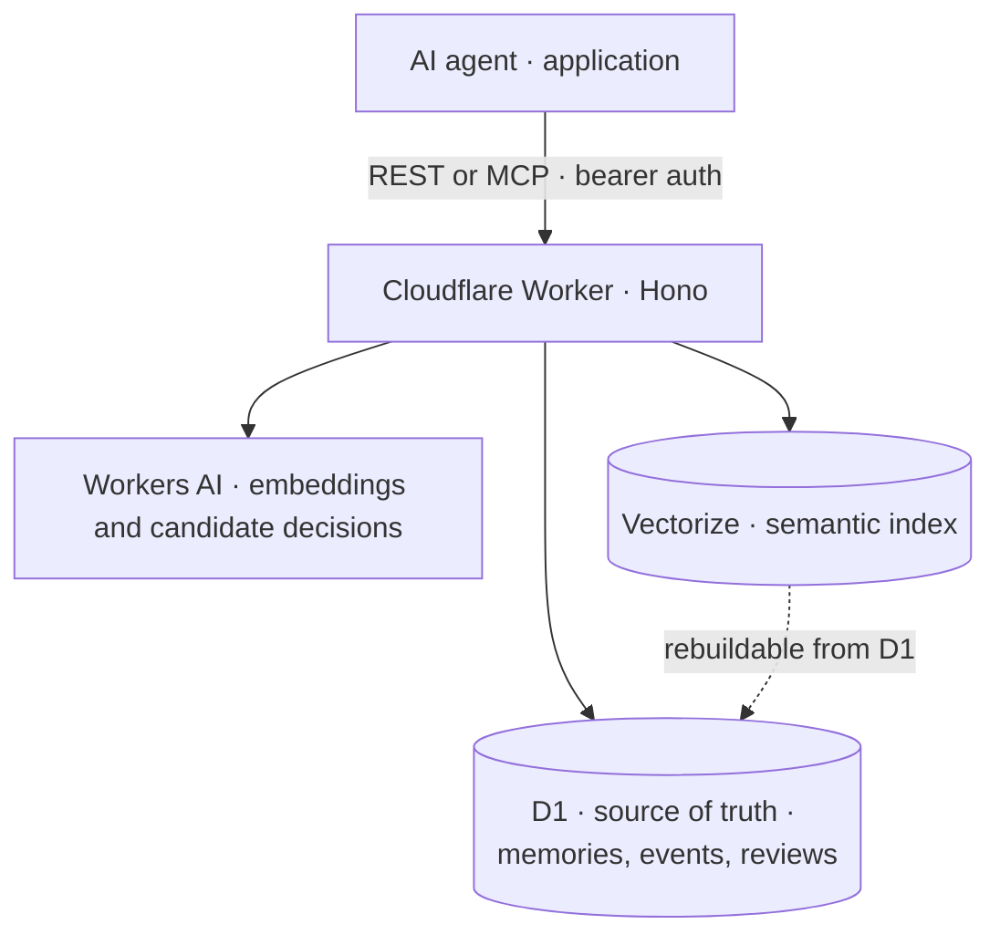

# Architecture

The Worker is the authenticated API. D1 is the source of truth for memories, events, and reviews. Vectorize stores semantic vectors and metadata filters; it can be rebuilt from D1. If an upsert fails, the D1 write remains and its index status is marked for repair.

Search combines Vectorize semantic results with a D1 lexical fallback. Request scope and `user_id` constrain visibility. The client integrations build session context from bounded memory selections rather than dumping the full library.

Unsupervised background classifiers submit candidates to the review queue. They do not write memories directly. A user or agent resolves each review through the API or the `/memory` audit workflow.

The main route and service boundaries are in `src/index.ts` and `src/services/`. D1 migrations are in `migrations/`; client-specific behavior is in `integrations/`.
